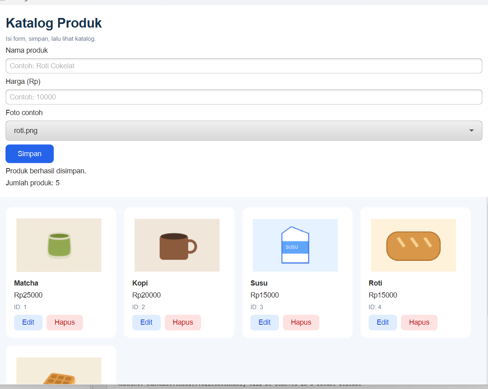
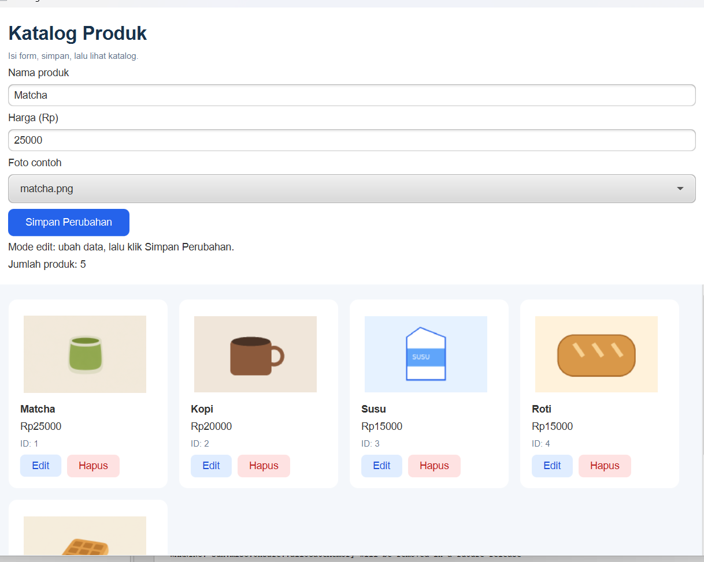
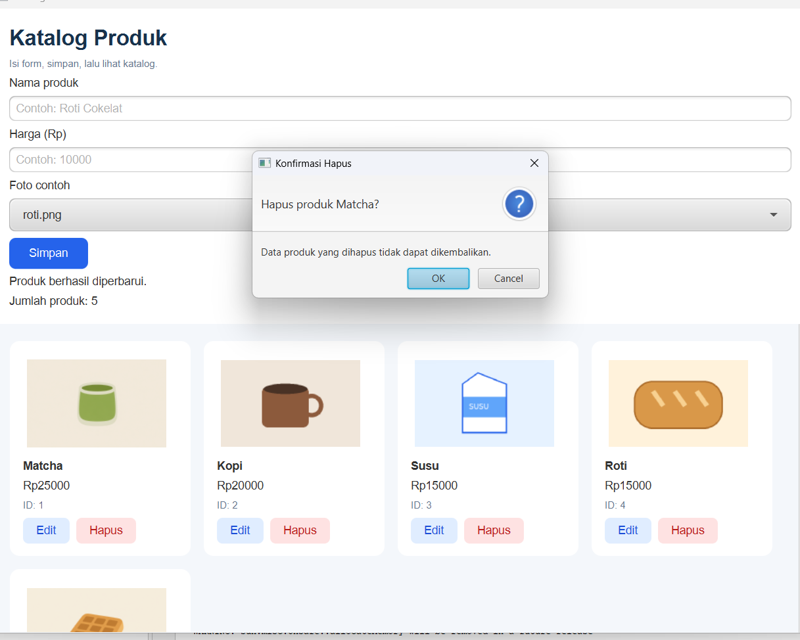

# Aplikasi Katalog Produk

Aplikasi Katalog Produk merupakan aplikasi desktop berbasis Java yang dikembangkan menggunakan JavaFX sebagai antarmuka pengguna (GUI). Aplikasi ini digunakan untuk mengelola data produk, mulai dari menambahkan, menampilkan, mengedit, hingga menghapus data produk beserta foto.

## Fitur Aplikasi

- Menambahkan data produk.
- Memilih foto produk yang tersedia.
- Menampilkan daftar produk beserta foto, nama, harga, dan ID produk.
- Mengedit informasi produk.
- Menghapus data produk.
- Menampilkan jumlah produk.
- Menyimpan data produk menggunakan database SQLite.

## Cara Menjalankan Aplikasi

### 1. Clone Repository

Buka terminal atau Command Prompt, kemudian jalankan perintah berikut:

```bash
git clone https://github.com/dafiputrag07-stack/KatalogProduk.git
```

### 2. Masuk ke Folder Project

```bash
cd KatalogProduk
```

### 3. Jalankan Aplikasi

Pastikan Java JDK dan Maven sudah terpasang di komputer.

Jalankan perintah berikut:

```bash
mvn clean javafx:run
```

Tunggu hingga proses build selesai. Aplikasi Katalog Produk UPI Store akan terbuka.

### 4. Menjalankan Melalui NetBeans IDE

1. Buka NetBeans IDE.
2. Pilih **File → Open Project**.
3. Pilih folder project hasil clone.
4. Tunggu hingga konfigurasi Maven selesai.
5. Klik kanan pada project, kemudian pilih **Run**.

## Cara Penggunaan

1. Buka aplikasi Katalog Produk UPI Store.
2. Masukkan nama produk.
3. Masukkan harga produk.
4. Pilih foto produk yang tersedia.
5. Klik tombol **Simpan** untuk menambahkan produk.
6. Gunakan fitur **Edit** untuk mengubah informasi produk.
7. Gunakan fitur **Hapus** untuk menghapus produk.

## Tampilan Aplikasi

### 1. Form Input dan Katalog Produk


### 2. Edit Produk


### 1. Hapus Produk

